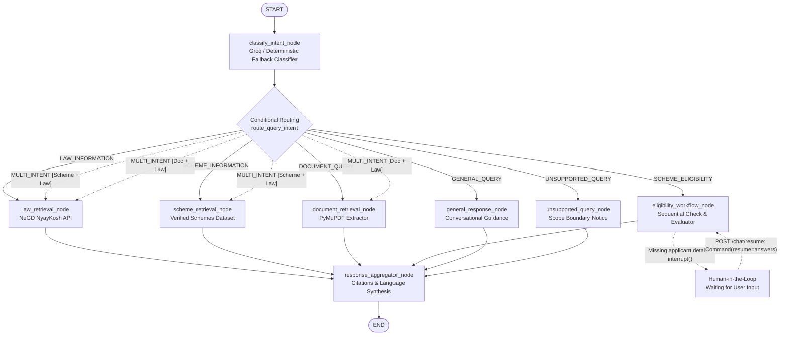

# NitiSetu — Multilingual Civic Information Assistant

> **Tagline:** Bridging Citizens with Knowledge.  
> **Current Version:** Phase 2 — Intelligent Query Orchestration Using LangGraph (`v2.0.0`)

---

## 1. Project Overview

**Problem Statement:**  
NitiSetu is an AI-powered multilingual civic information assistant designed to help Indian citizens understand:
1. **Government Schemes & Eligibility:** Understand welfare benefits and evaluate personal eligibility criteria using deterministic rule evaluation.
2. **Indian Laws & Citizen Rights:** Retrieve statutory provisions, parliamentary acts, and consumer/privacy protections from official sources (NeGD NyayKosh).
3. **Government Notices & Circulars:** Ingest official gazettes and PDFs uploaded by citizens, extracting text page-by-page.
4. **Intelligent Query Orchestration (Phase 2):** Classify user query intent using Groq LLM (with robust multilingual fallback), route execution dynamically, run parallel retrievals, pause for missing details via LangGraph human-in-the-loop checkpoints, and synthesize transparent, cited answers in English, Hindi, and Telugu.

---

## 2. Phase 2 Architecture: LangGraph Central Orchestration

In Phase 2, **LangGraph** (`StateGraph`) serves as the central orchestration engine connecting all civic domains into an adaptive directed acyclic execution graph.

### StateGraph Workflow Diagram



---

## 3. Core LangGraph Orchestration Capabilities

### 1. Intent Classification (Groq LLM + Deterministic Fallback)
- **Groq Integration:** Utilizes `AsyncGroq` with `llama-3.3-70b-versatile` to produce structured JSON conforming to `IntentClassification` schema.
- **Multilingual Support:** Handles English, Hindi (Devanagari Unicode `\u0900-\u097F`), and Telugu (Telugu script `\u0C00-\u0C7F` & transliterations).
- **Graceful Fallback:** If `GROQ_API_KEY` is absent or the API fails, `DeterministicFallbackClassifier` uses keyword analysis, boundary regex, and entity extraction to ensure 100% operational uptime (`source="fallback"`).

### 2. Conditional Routing & Dynamic Fan-Out
- Evaluates classified intent and secondary intents:
  - Single intent queries route directly to the responsible retrieval node.
  - Multi-intent queries (e.g. "Explain Ayushman Bharat and RTI Act") return a **list of nodes** (`["scheme_retrieval_node", "law_retrieval_node"]`), triggering LangGraph native parallel fan-out.

### 3. State Management & Parallel Safety
- Central `NitiSetuState` TypedDict:
  - List fields (`law_results`, `scheme_results`, `document_results`, `errors`) use `operator.add` reducer to safely combine results from parallel branches without state collisions.
  - Dictionary fields (`applicant_details`, `task_status`) use `merge_dict_reducer` for safe concurrent updates.

### 4. Human-in-the-Loop (HITL) Checkpoints
- Implements LangGraph 1.2+ `interrupt()` and `Command(resume=...)` inside `eligibility_workflow_node`:
  - When a citizen asks for eligibility without providing required parameters (e.g. land ownership, tax status), the node calls `interrupt({...})`.
  - The workflow execution halts cleanly, persists state in the checkpointer, and returns `status="waiting_for_user"` with structured `pending_questions`.
  - The citizen answers in the UI, which calls `POST /api/v1/chat/resume`.
  - LangGraph resumes from the pause point without re-running classification from scratch.

### 5. Checkpointer Persistence
- Primary Checkpointer: PostgreSQL via `langgraph-checkpoint-postgres` and `psycopg_pool` (compatible with Supabase PostgreSQL).
- Local / Test Checkpointer: Resilient in-memory fallback via `MemorySaver`.

### 6. Transparent Citations & Partial Failure Handling
- Aggregator node explicitly tags citations:
  - `⚖️ NeGD NyayKosh Official Legal Repository` (Live statute)
  - `🌾 Official Government Portal (Verified Demo Dataset)` (Verified scheme)
  - `📄 Uploaded Citizen Document` (User PDF)
- If one branch encounters an error (e.g. document not found or upstream timeout), other branches still complete, and a clear `⚠️ Partial Service Notice` is attached to the response (`partial_failure=True`).

---

## 4. Project Structure

```
NitiSetu/
│
├── frontend/
│   ├── public/
│   ├── src/
│   │   ├── components/
│   │   │   ├── chat/
│   │   │   │   └── IntelligentChatSection.jsx   # Phase 2: LangGraph Chat UI with HITL Questionnaire
│   │   │   ├── common/
│   │   │   │   └── BackendStatusBadge.jsx
│   │   │   ├── documents/
│   │   │   │   └── DocumentUploadSection.jsx
│   │   │   ├── laws/
│   │   │   │   └── LawSearchSection.jsx
│   │   │   ├── layout/
│   │   │   │   ├── Header.jsx
│   │   │   │   └── Footer.jsx
│   │   │   └── schemes/
│   │   │       └── SchemeExplorerSection.jsx
│   │   ├── pages/
│   │   │   └── Home.jsx
│   │   ├── services/
│   │   │   └── api.js                         # Phase 2: sendChatQuery, resumeChatQuery
│   │   ├── App.jsx
│   │   ├── index.css
│   │   └── main.jsx
│   ├── .env
│   ├── package.json
│   └── vite.config.js
│
├── backend/
│   ├── app/
│   │   ├── api/
│   │   │   ├── routes/
│   │   │   │   ├── __init__.py
│   │   │   │   ├── chat.py                    # Phase 2: /query, /resume, /history, /conversations
│   │   │   │   ├── document_routes.py
│   │   │   │   ├── health.py
│   │   │   │   ├── law_routes.py
│   │   │   │   └── scheme_routes.py
│   │   ├── core/
│   │   │   ├── config.py                      # Phase 2: Groq, Checkpointer, Supabase config
│   │   │   └── exceptions.py
│   │   ├── data/
│   │   │   └── schemes.json                   # 5 Verified Official Schemes
│   │   ├── graph/                             # Phase 2: LangGraph Core Engine
│   │   │   ├── __init__.py
│   │   │   ├── checkpointer.py                # PostgreSQL & MemorySaver lifecycle
│   │   │   ├── nodes.py                       # 8 Workflow nodes & interrupt() logic
│   │   │   ├── routing.py                     # Conditional routing & parallel fan-out
│   │   │   ├── state.py                       # NitiSetuState TypedDict & safe reducers
│   │   │   └── workflow.py                    # StateGraph compilation & edge wiring
│   │   ├── repositories/
│   │   │   ├── conversation_repository.py     # Thread turns persistence
│   │   │   ├── document_repository.py
│   │   │   └── scheme_repository.py
│   │   ├── schemas/
│   │   │   ├── chat_query_schema.py           # Phase 2: ChatQueryRequest, Response, PendingQuestion
│   │   │   ├── intent_schema.py               # Phase 2: IntentType, ExtractedEntities
│   │   │   ├── common_schemas.py
│   │   │   ├── document_schemas.py
│   │   │   ├── law_schemas.py
│   │   │   └── scheme_schemas.py
│   │   ├── services/
│   │   │   ├── intent_classifier_service.py   # Groq async LLM + Deterministic Fallback
│   │   │   ├── response_aggregator_service.py # Citations, multilingual, partial failure
│   │   │   ├── document_service.py
│   │   │   ├── eligibility_service.py
│   │   │   ├── nyaykosh_service.py
│   │   │   ├── pdf_extraction_service.py
│   │   │   └── scheme_service.py
│   │   ├── storage/
│   │   │   └── local_storage.py
│   │   └── main.py
│   ├── tests/
│   │   ├── test_chat_api.py                   # Phase 2: API lifecycle & HITL resume tests
│   │   ├── test_checkpointing.py              # Phase 2: Thread isolation tests
│   │   ├── test_conditional_routing.py        # Phase 2: Routing tests
│   │   ├── test_intent_classifier.py          # Phase 2: Groq & multilingual fallback tests
│   │   ├── test_interrupt_resume.py           # Phase 2: LangGraph interrupt() & Command(resume)
│   │   ├── test_multi_intent.py               # Phase 2: Aggregation & partial failure tests
│   │   ├── test_parallel_execution.py         # Phase 2: Concurrent branch execution tests
│   │   ├── test_sequential_execution.py       # Phase 2: Sequential eligibility tests
│   │   ├── test_document_routes.py            # Phase 1 tests
│   │   ├── test_health.py                     # Health & discovery tests
│   │   ├── test_law_routes.py                 # NyayKosh & mock adapter tests
│   │   ├── test_pdf_extraction.py             # PyMuPDF extraction tests
│   │   └── test_scheme_routes.py              # Scheme & eligibility tests
│   ├── uploads/
│   ├── .env
│   ├── .env.example
│   └── requirements.txt
│
├── .gitignore
└── README.md
```

---

## 5. API Endpoints

### Phase 2: Intelligent LangGraph Chat Orchestration
| Method | Endpoint | Description |
|---|---|---|
| `POST` | `/api/v1/chat/query` | Submit query for LangGraph execution. Returns `completed` or `waiting_for_user` (interrupt). |
| `POST` | `/api/v1/chat/resume` | Resume paused thread with citizen answers via `Command(resume=answers)`. |
| `GET` | `/api/v1/chat/history/{conversation_id}` | Retrieve chronological message history for a thread. |
| `GET` | `/api/v1/chat/conversations` | List active conversation thread summaries. |
| `POST` | `/api/v1/chat/test` | Phase 0 verification stub (backward-compatibility). |

### Phase 1: Domain Information Endpoints
- **Laws (NyayKosh):** `GET /api/v1/laws/search?q={query}`
- **Schemes:** `GET /api/v1/schemes`, `GET /api/v1/schemes/{id}`, `POST /api/v1/schemes/{id}/eligibility/evaluate`
- **Documents:** `POST /api/v1/documents/upload`, `GET /api/v1/documents/{id}/pages`
- **System:** `GET /api/v1/health`, `GET /`

---

## 6. Setup & Running Instructions

### 1. Backend Setup
```powershell
cd backend
python -m uvicorn app.main:app --reload --host 127.0.0.1 --port 8000
```
- OpenAPI Documentation: [http://localhost:8000/docs](http://localhost:8000/docs)
- Health Check: [http://localhost:8000/api/v1/health](http://localhost:8000/api/v1/health)

### 2. Frontend Setup
```bash
cd frontend
npm run dev
```
- Web Application: [http://localhost:5173](http://localhost:5173)

---

## 7. Automated Testing Suite

All 51 automated unit and integration tests across Phase 0, Phase 1, and Phase 2 pass with 100% success:

```powershell
python -m pytest backend/tests -v
```

```
======================= 51 passed, 2 warnings in 5.24s ========================
```

The test suite covers:
1. Groq intent classification and multilingual fallback (English, Hindi, Telugu)
2. Conditional routing to all 6 distinct branch targets
3. Parallel concurrent branch execution (Document + Law, Scheme + Law)
4. Sequential eligibility pipeline execution
5. LangGraph `interrupt()` pause when parameters are incomplete
6. Resumption via `Command(resume=answers)` without graph re-execution
7. Thread isolation across independent conversation checkpoints
8. Response aggregation distinguishing NeGD NyayKosh from verified demo data
9. Graceful partial failure reporting when a single branch fails
10. Full end-to-end API lifecycle via FastAPI `TestClient`
