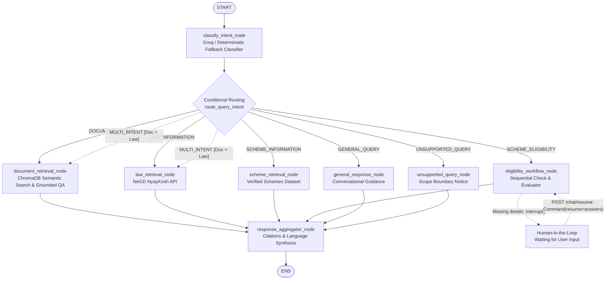

# NitiSetu — Multilingual Civic Information Assistant

> **Tagline:** Bridging Citizens with Knowledge.  
> **Current Version:** Phase 3 — Document Intelligence using RAG (`v3.0.0`)

---

## 1. Project Overview

**Problem Statement:**  
NitiSetu is an AI-powered multilingual civic information assistant designed to help Indian citizens understand:
1. **Government Schemes & Eligibility:** Understand welfare benefits and evaluate personal eligibility criteria using deterministic rule evaluation.
2. **Indian Laws & Citizen Rights:** Retrieve statutory provisions, parliamentary acts, and consumer/privacy protections from official sources (NeGD NyayKosh).
3. **Government Notices & Circulars (Phase 3 RAG):** Ingest official gazettes and policy orders, clean and chunk text, generate multilingual embeddings via Sentence Transformers, store them in ChromaDB, and synthesize grounded answers citing exact page numbers.
4. **Intelligent Query Orchestration (Phase 2):** Classify user query intent using Groq LLM (with robust multilingual fallback), route execution dynamically, run parallel retrievals, pause for missing details via LangGraph human-in-the-loop checkpoints, and synthesize transparent, cited answers in English, Hindi, and Telugu.

---

## 2. Phase 3 Architecture: Document Intelligence using RAG

Phase 3 introduces an end-to-end local Retrieval-Augmented Generation (RAG) pipeline for citizen-uploaded documents.

### Document Indexing & Query Pipeline

```mermaid
flowchart TD
    subgraph Ingestion ["1. Document Ingestion & Indexing Lifecycle"]
        PDF[Citizen PDF Upload] --> Validate[File & Magic Byte Validation]
        Validate --> Extract[PyMuPDF Page-by-Page Extraction]
        Extract --> OCR{Scanned / Image?}
        OCR -->|Yes| OCR_REQ[Status: OCR_REQUIRED]
        OCR -->|No| Clean[TextCleaningService<br/>Normalize Whitespace & Artifacts]
        Clean --> Chunk[ChunkingService<br/>Heading & Paragraph Aware]
        Chunk --> Embed[EmbeddingService<br/>Sentence Transformers Multilingual]
        Embed --> Chroma[(ChromaDB Persistent Store<br/>./storage/chroma)]
        Chroma --> Indexed[Status: INDEXED]
    end

    subgraph Retrieval ["2. Semantic Retrieval & Grounded Q&A"]
        Q[Citizen Document Query] --> QEmbed[Query Embedding]
        QEmbed --> Search[ChromaDB Vector Search<br/>Mandatory User & Document Isolation]
        Search --> Chunks[Top-K Relevant Chunks<br/>Threshold Calibrated]
        Chunks --> Assembly[Grounded Context Assembly<br/>Page-Level Provenance]
        Assembly --> Groq[Groq LLM Synthesis<br/>Prompt Injection Defenses]
        Groq --> Response[Grounded Answer<br/>Exact Page Citations & Grounding Status]
    end
```



### Core Document Intelligence Capabilities
1. **Text Cleaning (`TextCleaningService`):**
   - Normalizes whitespace, repeated newlines, and running headers/footers (`Page X of Y`, official gazette stamps).
   - Preserves legal section numbers, act names, headings, dates, and tabular columns without destructive truncation.
2. **Intelligent Chunking (`ChunkingService`):**
   - Splits text on semantic paragraph and section heading boundaries (`Section \d+`, `Article \d+`, `Rule \d+`).
   - Configurable token size (default: 800) and overlap (default: 150).
   - Accurately tracks multi-page spans (`page_start`, `page_end`, and primary `page_number`).
3. **Sentence Transformers Embedding Service (`EmbeddingService`):**
   - Uses `sentence-transformers/paraphrase-multilingual-MiniLM-L12-v2` for local multilingual embeddings (English, Hindi, Telugu).
   - Normalized vectors for cosine similarity; 100% local inference with zero third-party data leakage.
4. **Persistent ChromaDB Vector Store (`ChromaStorage`):**
   - Persistent vector storage in `./storage/chroma`.
   - Idempotent indexing: re-indexing removes prior chunks cleanly without duplicates.
   - Strict metadata filtering on `user_id` ensuring complete citizen privacy isolation.
5. **Grounded Answer Generation (`DocumentQAService`):**
   - Uses Groq with low temperature (`0.1`) and prompt-injection defenses (treating uploaded document contents strictly as untrusted data).
   - Outputs grounding status (`GROUNDED`, `PARTIALLY_GROUNDED`, `INSUFFICIENT_CONTEXT`).
   - Cites exact page numbers (e.g. `[Page 2]`) for all factual assertions.
   - If the document does not contain sufficient context, explicitly returns: *"I could not find sufficient information about this in the uploaded document."*

---

## 3. LangGraph Orchestration Integration

Document RAG connects directly into the central LangGraph StateGraph:



---

## 4. Complete Project Structure

```
NitiSetu/
│
├── frontend/
│   ├── public/
│   ├── src/
│   │   ├── components/
│   │   │   ├── chat/
│   │   │   │   └── IntelligentChatSection.jsx   # Phase 2: LangGraph Chat UI with HITL Questionnaire
│   │   │   ├── common/
│   │   │   │   └── BackendStatusBadge.jsx
│   │   │   ├── documents/
│   │   │   │   └── DocumentUploadSection.jsx    # Phase 3: RAG Q&A, Indexing Lifecycle & Chunk Viewer
│   │   │   ├── laws/
│   │   │   │   └── LawSearchSection.jsx
│   │   │   ├── layout/
│   │   │   │   ├── Header.jsx
│   │   │   │   └── Footer.jsx
│   │   │   └── schemes/
│   │   │       └── SchemeExplorerSection.jsx
│   │   ├── pages/
│   │   │   └── Home.jsx
│   │   ├── services/
│   │   │   └── api.js                         # Document RAG & indexing API methods
│   │   ├── App.jsx
│   │   ├── index.css
│   │   └── main.jsx
│   ├── .env
│   ├── package.json
│   └── vite.config.js
│
├── backend/
│   ├── app/
│   │   ├── api/
│   │   │   ├── routes/
│   │   │   │   ├── __init__.py
│   │   │   │   ├── chat.py                    # LangGraph endpoints (/query, /resume, /history)
│   │   │   │   ├── document_routes.py         # Phase 3: /index, /status, /query, /chunks
│   │   │   │   ├── health.py
│   │   │   │   ├── law_routes.py
│   │   │   │   └── scheme_routes.py
│   │   ├── core/
│   │   │   ├── config.py                      # Phase 3: ChromaDB & Sentence Transformer config
│   │   │   └── exceptions.py
│   │   ├── data/
│   │   │   └── schemes.json                   # 5 Verified Official Schemes
│   │   ├── graph/                             # LangGraph Core Engine
│   │   │   ├── __init__.py
│   │   │   ├── checkpointer.py                # PostgreSQL & MemorySaver lifecycle
│   │   │   ├── nodes.py                       # Upgraded document_retrieval_node with RAG
│   │   │   ├── routing.py                     # Conditional routing & parallel fan-out
│   │   │   ├── state.py                       # NitiSetuState TypedDict & safe reducers
│   │   │   └── workflow.py                    # StateGraph compilation & edge wiring
│   │   ├── repositories/
│   │   │   ├── conversation_repository.py     # Thread turns persistence
│   │   │   ├── document_repository.py         # Document metadata & page store
│   │   │   └── scheme_repository.py
│   │   ├── schemas/
│   │   │   ├── document_schemas.py            # Phase 3: Chunk, RAG Q&A, and indexing schemas
│   │   │   ├── chat_query_schema.py
│   │   │   ├── intent_schema.py
│   │   │   ├── common_schemas.py
│   │   │   ├── law_schemas.py
│   │   │   └── scheme_schemas.py
│   │   ├── services/
│   │   │   ├── text_cleaning_service.py       # Phase 3: Text cleaning & artifact removal
│   │   │   ├── chunking_service.py            # Phase 3: Paragraph & heading aware chunker
│   │   │   ├── embedding_service.py           # Phase 3: Sentence Transformers embedder
│   │   │   ├── document_retrieval_service.py  # Phase 3: Semantic retrieval & threshold filtering
│   │   │   ├── document_qa_service.py         # Phase 3: Grounded Groq RAG answer synthesis
│   │   │   ├── document_service.py            # Document processing & indexing orchestrator
│   │   │   ├── intent_classifier_service.py
│   │   │   ├── response_aggregator_service.py
│   │   │   ├── eligibility_service.py
│   │   │   ├── nyaykosh_service.py
│   │   │   ├── pdf_extraction_service.py
│   │   │   └── scheme_service.py
│   │   ├── storage/
│   │   │   ├── chroma_storage.py              # Phase 3: Persistent ChromaDB vector storage
│   │   │   └── local_storage.py               # Secure isolated PDF binary storage
│   │   └── main.py
│   ├── tests/
│   │   ├── test_chunking.py                   # Phase 3: Chunking & heading tests
│   │   ├── test_embedding_service.py          # Phase 3: Embedding generation & dimension tests
│   │   ├── test_chroma_storage.py             # Phase 3: ChromaDB vector search & isolation tests
│   │   ├── test_document_rag.py               # Phase 3: Document RAG Q&A & grounding tests
│   │   ├── test_langgraph_rag.py              # Phase 3: LangGraph RAG node & parallel tests
│   │   ├── test_chat_api.py                   # Phase 2 tests
│   │   ├── test_checkpointing.py              # Phase 2 tests
│   │   ├── test_conditional_routing.py        # Phase 2 tests
│   │   ├── test_intent_classifier.py          # Phase 2 tests
│   │   ├── test_interrupt_resume.py           # Phase 2 tests
│   │   ├── test_multi_intent.py               # Phase 2 tests
│   │   ├── test_parallel_execution.py         # Phase 2 tests
│   │   ├── test_sequential_execution.py       # Phase 2 tests
│   │   ├── test_document_routes.py            # Phase 1 tests
│   │   ├── test_health.py                     # Phase 0 tests
│   │   ├── test_law_routes.py                 # Phase 1 tests
│   │   ├── test_pdf_extraction.py             # Phase 1 tests
│   │   └── test_scheme_routes.py              # Phase 1 tests
│   ├── storage/
│   │   └── chroma/                            # Persistent ChromaDB vector data
│   ├── uploads/                               # Safe local PDF storage
│   ├── .env
│   ├── .env.example
│   └── requirements.txt
│
├── .gitignore
└── README.md
```

---

## 5. API Endpoints

### Phase 3: Document Intelligence & RAG
| Method | Endpoint | Description |
|---|---|---|
| `POST` | `/api/v1/documents/upload` | Upload PDF, extract pages, and automatically initiate RAG indexing. |
| `POST` | `/api/v1/documents/{document_id}/index` | Trigger or retry text cleaning, chunking, embedding, and ChromaDB indexing. |
| `GET` | `/api/v1/documents/{document_id}/status` | Retrieve indexing status (`INDEXED`, `OCR_REQUIRED`, `FAILED`, etc.) and chunk counts. |
| `POST` | `/api/v1/documents/{document_id}/query` | Ask a natural language question against a specific document using semantic RAG. |
| `POST` | `/api/v1/documents/query` | Semantic search across all authorized documents belonging to the citizen. |
| `GET` | `/api/v1/documents/{document_id}/chunks` | Inspect indexed chunks and metadata with ownership verification. |
| `GET` | `/api/v1/documents/{document_id}/pages` | Retrieve page-by-page extracted text. |
| `GET` | `/api/v1/documents/{document_id}` | Retrieve document metadata. |
| `GET` | `/api/v1/documents/` | List all documents uploaded by the user. |
| `DELETE` | `/api/v1/documents/{document_id}` | Delete document file, metadata, and ChromaDB vector chunks. |

### Phase 2: LangGraph Chat Orchestration
| Method | Endpoint | Description |
|---|---|---|
| `POST` | `/api/v1/chat/query` | Unified LangGraph query entrypoint (intent classification, parallel fan-out, RAG). |
| `POST` | `/api/v1/chat/resume` | Resumes paused workflow with citizen answers via `Command(resume=answers)`. |
| `GET` | `/api/v1/chat/history/{id}` | Chronological message history for a conversation thread. |
| `GET` | `/api/v1/chat/conversations` | List active conversation thread summaries. |

### Phase 1: Laws & Schemes
- **Laws (NyayKosh):** `GET /api/v1/laws/search?q={query}`
- **Schemes:** `GET /api/v1/schemes`, `GET /api/v1/schemes/{id}`, `POST /api/v1/schemes/{id}/eligibility/evaluate`
- **System:** `GET /api/v1/health`, `GET /`

---

## 6. Running Instructions

### 1. Backend Setup
```powershell
cd backend
python -m uvicorn app.main:app --reload --host 127.0.0.1 --port 8000
```
- OpenAPI Documentation: [http://localhost:8000/docs](http://localhost:8000/docs)
- Health Check: [http://localhost:8000/api/v1/health](http://localhost:8000/api/v1/health)

### 2. Frontend Setup
```bash
cd frontend
npm run dev
```
- Web Application: [http://localhost:5173](http://localhost:5173)

---

## 7. Automated Testing Suite

All unit, integration, and RAG tests pass:

```powershell
python -m pytest backend/tests -v
```

The test suite covers:
1. PDF validation, page-level text extraction, and OCR detection
2. Document text cleaning and whitespace normalization
3. Heading- and paragraph-aware text chunking with page span tracking
4. Sentence Transformers embedding generation (multilingual probe and dimensions)
5. Persistent ChromaDB storage, vector retrieval, and user ownership isolation
6. Grounded RAG answer generation, prompt-injection defense, and page citations
7. LangGraph `document_retrieval_node` semantic RAG and parallel multi-intent execution
8. Full end-to-end FastAPI endpoint lifecycles
